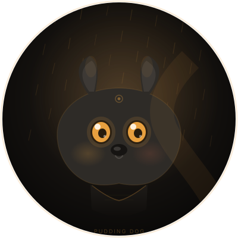

# 【你的名字】個人網站

純靜態網站，不需要安裝任何東西。整個資料夾就是網站本身。

---

## 怎麼看

**方式一：直接用伺服器開啟（推薦，功能最完整）**

```powershell
powershell -ExecutionPolicy Bypass -File .\dev-server.ps1
```

然後開啟 <http://localhost:8123/>
按 `Ctrl + C` 停止。

**方式二：直接雙擊 `index.html`**
也能看，但社群連結、部分瀏覽器行為會有限制。之後要上線還是得走方式一或託管平台。

---

## 檔案結構

```
index.html              ← 整個網站的內容都在這裡（唯一需要你編輯的檔案）
dev-server.ps1          ← 本機預覽用的小伺服器，正式上線不需要
assets/
  css/style.css         ← 樣式。想改顏色看下面「改顏色」
  js/main.js            ← 互動效果（選單、主題切換、進場動畫、複製 Email）
  portrait.svg          ← 大頭照位置，換成你的照片
  favicon.svg           ← 瀏覽器分頁的小圖示
```

---

## 填內容

打開 `index.html`，**把所有 `【　】` 換掉**。全站只有 20 幾處，都是照著順序從上到下。

用 VS Code 的 Ctrl+H「取代全部」會最快。

需要重複的區塊（作品、經歷）直接複製整個 `<article class="work-card">` 或 `<li>` 區塊就好。

### 換大頭照

把你的照片放進 `assets/`，然後在 `index.html` 找到這行改檔名：

```html

```

正方形照片效果最好（建議至少 600×600）。

### 換 favicon

改 `assets/favicon.svg` 裡面的色塊，或直接換成你的 `.png` / `.ico`，
再把 `index.html` 裡的 `<link rel="icon">` 路徑改掉。

### 換社群分享預覽圖

做一張 1200×630 的圖存成 `assets/og-image.png`。
這張會出現在別人把你的連結傳到 LINE、Facebook 時的預覽卡片，很值得做。

---

## 改顏色

打開 `assets/css/style.css`，最上面有兩組變數：

```css
[data-theme="dark"]  { --accent: #ff5c38; ... }   /* 深色模式 */
[data-theme="light"] { --accent: #d2431c; ... }   /* 淺色模式 */
```

主要可調的：

| 變數 | 用途 |
|---|---|
| `--accent` | 強調色（連結、按鈕、重點字） |
| `--bg` / `--bg-alt` | 背景 |
| `--text` / `--muted` | 文字、輔助文字 |
| `--radius-lg` | 圓角大小 |

想完全換一個色系，改 `--accent` 兩個值就夠了，其餘會自動跟著變。

---

## 已內建的功能

- 深色／淺色模式切換，記住你的選擇
- 手機版自動變漢堡選單
- 捲動時導覽列自動高亮目前區段
- 進場淡入動畫（已加保險，動畫沒跑也一定看得到內容）
- 點一下就複製 Email
- 手機、平板、桌機都自動適應
- 已填好 SEO 標籤與結構化資料（Google 搜尋會顯示你的名字與一句話介紹）
- 支援「減少動畫」系統設定

---

## 之後要上線

檔案已經是純靜態的，以下任一個平台拖上去就能用：

| 平台 | 做法 | 適合 |
|---|---|---|
| **Netlify** | <https://app.netlify.com/drop> 把整個資料夾拖進去 | 最快，兩分鐘搞定 |
| **Vercel** | 匯入 GitHub 儲存庫 | 每次推自動部署 |
| **GitHub Pages** | 推上 GitHub → Settings → Pages | 免費、有 `帳號.github.io` 網址 |
| **Cloudflare Pages** | 連接 GitHub | 國內連線速度最快 |

有了網域之後，設定一個 CNAME 指過去就完成了。

> 上線時不需要 `dev-server.ps1`，那是本機預覽用的。
